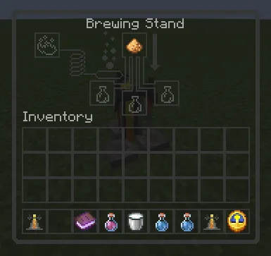
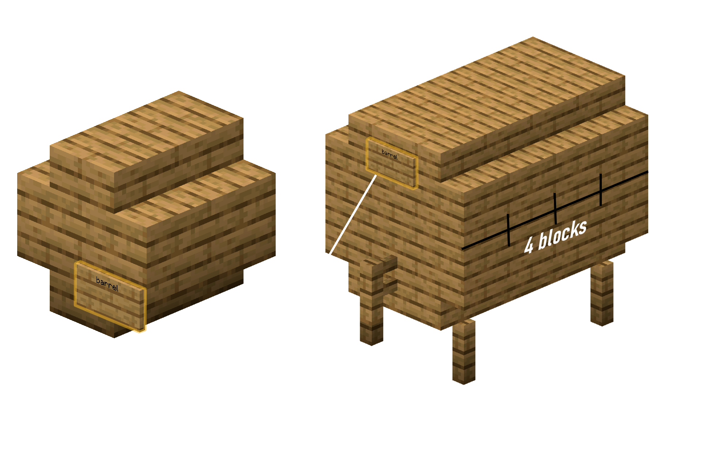

# 🍺 BreweryX Pruulimise Juhend (Brewing Guide)

Põhjalik ja lihtne juhend, kuidas Minecraftis jooke pruulida, vaate ehitada ning retsepte valmistada.

---

## 🏗️ Pruulikoja Seadmed ja Valmistamine

Pruulimiseks läheb vaja kolme põhilist seadet: **Katel**, **Destilleerimisalus** ja **Vaat**.

---

### 1. 🍲 Katel (Keetmine)
- Pane katla alla tuleallikas: **Lõke (`Campfire`)**, laava või põlev põrgukivi (`Netherrack`).
- Täida katel veega.
- Viska retseptis nõutud koostisosad otse vette.
- **Aja kontrollimine:** Vajuta **kellaga (`Clock`)** katlale — see näitab, mitu minutit pruulis on keenud.
- Kui aeg on käes, võta vedelik välja **tühja klaaspudeliga** (üks katel annab 3 pudelit).

> ⚠️ **Tähtis:** Keetmisaeg loetakse reaalsetes minutites! Õige ajastus tagab joogi kõrge kvaliteedi.

---

### 2. ⚗️ Pruulimisalus (Destilleerimine)
Vajalik ainult kangete jookide jaoks (nt viski, viin, rumm).



1. Aseta katlast võetud pudelid pruulimisalusele (`Brewing Stand`).
2. Pane ülemisse pessa filtrina **helendav tolm (`Glowstone Dust`)**.
3. Kütuseks kasuta tavapärast **tulepulbrit (`Blaze Powder`)**.
4. Iga tsükkel loetakse üheks destilleerimiseks (~40 sekundit). Tee täpselt nii mitu korda, kui retsept nõuab!

---

### 3. 🪵 Vaadid (Laagerdumine / Aging)
Laagerdumine muudab joogi maitset, värvi, kangust ja annab eriefekte. **1 Minecrafti aasta vaadis = 20 minutit päris aega.**



#### Vaatide tüübid:
| Vaadi tüüp | Maht | Kuidas ehitada |
| :--- | :---: | :--- |
| **Väike vaat (Small)** | 9 sloti | 8 puidust treppi ringis. Esiküljele pane silt (`Sign`), mille esimesele reale kirjuta: `Barrel`. |
| **Suur vaat (Big)** | 27 sloti | 4 aeda (jalad) + 16 treppi + 18 puitplanku. Esiküljele silt: `Barrel`. |
| **Vanilla tünn (`Barrel`)** | 27 sloti | Tavalist Minecrafti vanilla tünni loetakse **Tammeks (`Oak`)**. |

> 📌 **Avamine:** Paremklõps sildil avab vaadi inventari. Pane joogid sisse ja laagerdumine algab automaatselt!

#### Puidu tüübid:
Erinevad joogid nõuavad kindlat puitu:
- **Tamm (`Oak`)**
- **Kask (`Birch`)**
- **Kuusk (`Spruce`)**
- **Tume tamm (`Dark Oak`)**
- **Akatsia (`Acacia`)**
- **Džunglipuit (`Jungle`)**

---

## ⭐ Joogi Kvaliteet (Quality)

Kvaliteet (1 kuni 5 tärni) sõltub sellest, kui täpselt sa retsepti järgisid:
* **1 tärn ⭐:** Tehtud vigu (vale aeg, vale puit või destillatsioon) — joogil võivad olla halvad kõrvalmõjud.
* **3 tärni ⭐⭐⭐:** Standardne korralik jook.
* **5 tärni ⭐⭐⭐⭐⭐:** Täiuslikult valmistatud parim jook tugevate boonusefektidega.

---

## 🥴 Joove (Drunkenness) ja Kainenemine

Iga alkohoolne jook tõstab mängija joobe taset:
* **Kerge (1–30%):** Ekraan ujub kergelt, vestluses vahel komistad.
* **Keskmine (31–60%):** Mängija kõnnib viltu, vestlus (chat) moonutab sõnu, kerge iiveldus.
* **Raske (61–90%):** Tugev ekraani kõikumine, pimedus ja nõrkus.
* **Kriitiline (91–100%):** Mängija minestab (kukub pikali/ärkab suvalises kohas) või oksendab.

### Kuidas kaineks saada?
- 🥛 **Piim (`Milk`):** Eemaldab hetkelised mürgid/olekud, kuid joovet langetab vähe.
- ☕ **Kohv (`Coffee`) või Jääkohv:** Parim vahend! Ravib kiiresti joobe täiesti kaineks!
- ⏳ **Aeg:** Oota rahulikult, joove langeb iseenesest paari minutiga.

---

## 💻 Kasulikud Käsud

```text
/brew help           vaata Brewery abiinfot
/brew info           kontrolli oma praegust joobe taset ja kvaliteeti
/brew info <mängija> vaata teise mängija joovet
```

---

## 📜 Retseptid (Kõik joogid)

### 🌾 Õlled (Beer)
* **Tavaline õlu (Beer):**
  - **Koostis:** 6x Nisu (`Wheat`)
  - **Keetmine:** 8 min
  - **Vaat:** Suvaline puit — 3 aastat (60 min)
* **Nisuõlu (Wheatbeer):**
  - **Koostis:** 3x Nisu (`Wheat`)
  - **Keetmine:** 8 min
  - **Vaat:** Kask (`Birch`) — 2 aastat (40 min)
* **Tume õlu (Darkbeer):**
  - **Koostis:** 6x Nisu (`Wheat`)
  - **Keetmine:** 8 min
  - **Vaat:** Tume tamm (`Dark Oak`) — 8 aastat

---

### 🍇 Vein ja Mõdi (Wine & Mead)
* **Punane vein (Red Wine):**
  - **Koostis:** 5x Magusad marjad (`Sweet Berries`)
  - **Keetmine:** 5 min
  - **Vaat:** Suvaline puit — 20 aastat
* **Mõdi (Mead):**
  - **Koostis:** 6x Suhkruroog (`Sugar Cane`)
  - **Keetmine:** 3 min
  - **Vaat:** Tamm (`Oak`) — 4 aastat
* **Õuna-mõdi (Apple Mead):**
  - **Koostis:** 6x Suhkruroog + 2x Õun (`Apple`)
  - **Keetmine:** 4 min
  - **Vaat:** Tamm (`Oak`) — 4 aastat
  - *Efekt:* Vee all hingamine (`Water Breathing`)!
* **Õunasiider (Apple Cider):**
  - **Koostis:** 14x Õun (`Apple`)
  - **Keetmine:** 7 min
  - **Vaat:** Suvaline puit — 3 aastat

---

### 🥃 Kanged joogid (Spirits)
* **Viski (Whiskey):**
  - **Koostis:** 10x Nisu (`Wheat`)
  - **Keetmine:** 10 min
  - **Destilleeri:** 2 korda
  - **Vaat:** Kuusk (`Spruce`) — 18 aastat
* **Tuleviski (Fire Whiskey):**
  - **Koostis:** 10x Nisu + 2x Tulepulber (`Blaze Powder`)
  - **Keetmine:** 10 min
  - **Destilleeri:** 2 korda
  - **Vaat:** Kuusk (`Spruce`) — 20 aastat
* **Viin (Vodka):**
  - **Koostis:** 10x Kartul (`Potato`)
  - **Keetmine:** 15 min
  - **Destilleeri:** 2 korda
  - **Vaat:** Ei vaja laagerdumist (0 aastat)
* **Seeneviin (Mushroom Vodka):**
  - **Koostis:** 10x Kartul + 3x Pruun seen + 3x Punane seen
  - **Keetmine:** 18 min
  - **Destilleeri:** 3 korda
  - **Vaat:** Suvaline puit — 3 aastat
* **Džinn (Gin):**
  - **Koostis:** 9x Nisu + 6x Rukkilill/Sinilill (`Cornflower`) + 1x Õun
  - **Keetmine:** 6 min
  - **Destilleeri:** 2 korda
  - **Vaat:** Ei vaja laagerdumist
* **Rumm (Rum):**
  - **Koostis:** 18x Suhkruroog (`Sugar Cane`)
  - **Keetmine:** 6 min
  - **Destilleeri:** 2 korda
  - **Vaat:** Tamm (`Oak`) — 14 aastat
* **Tequila:**
  - **Koostis:** 8x Kaktus (`Cactus`)
  - **Keetmine:** 15 min
  - **Destilleeri:** 2 korda
  - **Vaat:** Ei vaja laagerdumist (või tamm 12 aastat)
* **Absint (Absinthe):**
  - **Koostis:** 15x Rohi (`Grass`)
  - **Keetmine:** 3 min
  - **Destilleeri:** 6 korda
  - **Vaat:** Ei vaja laagerdumist

---

### ☕ Mittealkohoolsed joogid
* **Kohv (Coffee):**
  - **Koostis:** 12x Kakaooad (`Cocoa Beans`) + 2x Piimaämber (`Milk Bucket`)
  - **Keetmine:** 2 min
  - *Efekt:* Annab kiirust (`Speed`) ja ravib purjusolekut!
* **Jääkohv (Iced Coffee):**
  - **Koostis:** 12x Kakaooad + 2x Piim + 1x Jää (`Ice`)
  - **Keetmine:** 2 min
* **Kuum šokolaad (Hot Chocolate):**
  - **Koostis:** 6x Kakaooad + 1x Piim + 2x Suhkur
  - **Keetmine:** 3 min
* **Kartulisupp (Potato Soup):**
  - **Koostis:** 5x Kartul + 3x Rohi (`Grass`)
  - **Keetmine:** 3 min
